# P(DOOM) — a Blender reconstruction

**A 2:36 music video rebuilt with real Blender modelling, lighting, cameras and EEVEE rendering.**

This is an independent reconstruction of [mexicat/pdoom-video](https://github.com/mexicat/pdoom-video) —
a generative WebGL music video for *"I'm Upping My P(doom)"*. The original is TypeScript + three.js;
this version is a Python scene toolkit for **Blender 5.2**, 22 plates, 4702 frames at 1920×1080 / 30 fps.

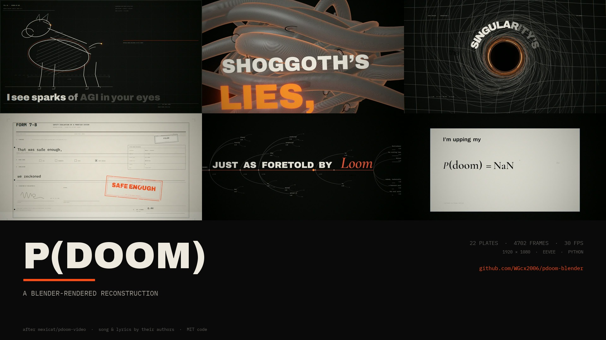

## Watch

- **[Full film — 1080p, with the song](https://github.com/WGcx2006/pdoom-blender/releases/download/v1.0.0/pdoom-blender-1080p.mp4)** (172 MB)
- **[540p preview](https://github.com/WGcx2006/pdoom-blender/releases/download/v1.0.0/pdoom-preview-540p.mp4)** (20 MB)
- **[31 s silent highlight](docs/highlight.mp4)** (in this repository)
- **[60-frame contact sheet](docs/contact-sheet.jpg)** and **[cut-boundary sheet](docs/cut-boundary-sheet.jpg)**

The song and lyrics are not covered by this repository's license. The release video is a
non-commercial demonstration; all rights remain with the authors. See [NOTICE.md](NOTICE.md).

## Specs

| | |
|---|---|
| runtime | 156.73 s (2:36.73) |
| frames | 4702 @ 30 fps |
| resolution | 1920 × 1080 |
| renderer | Blender 5.2, EEVEE, motion blur, bloom/halation/dispersion |
| finish | ffmpeg: 4/255 film grain + PI/7 vignette, AAC 192 kbps |
| code | Python scene modules, ~17 modules for 22 plates |

## What this is

- A **Blender-native** re-staging of the original treatment: real 3D rooms, tentacles, paperclips,
  transformer stacks, laptops, a tilt table, a theatre, a paper equation sheet, and a lot of
  typography.
- A deterministic renderer: every plate is a pure function of song time, built from word-level
  lyric timings and the beat grid.
- A study in translating a 2D/WebGL look — ink, bone, one signal orange, engraving, Swiss type —
  into Blender materials, line geometry, area lights and a compositor.

## What it is not

- It is not the original code, and it does not vendor the original project, song, fonts or timing
  data. It reads those from a local checkout created by `scripts/fetch_source.py`.
- It is not a pixel-perfect copy. The original is 60 fps and uses raymarched shaders for its
  engraving; this version is 30 fps and uses real 3D geometry plus planar hatching.

## Stills

| | |
|---|---|
| 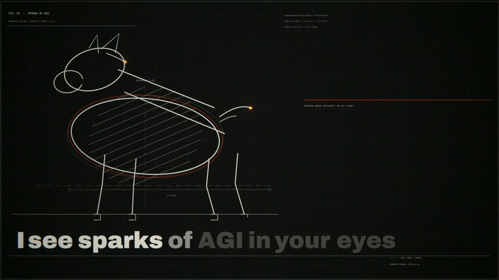 | 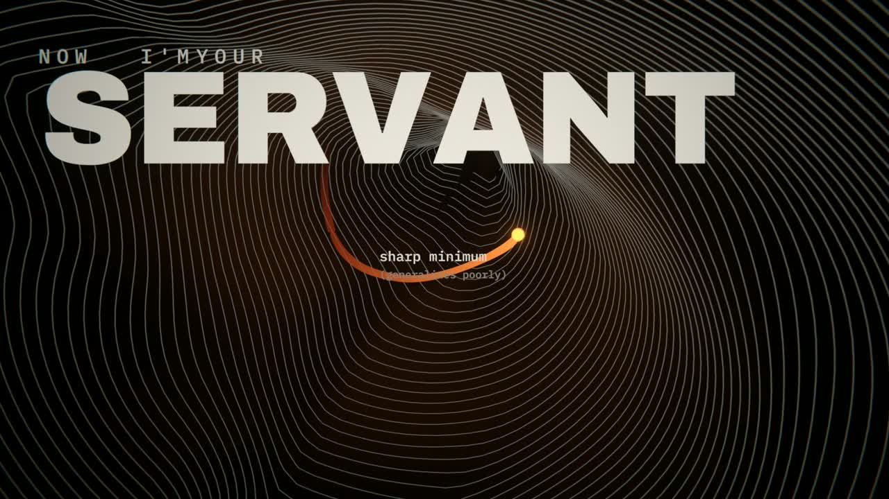 |
| 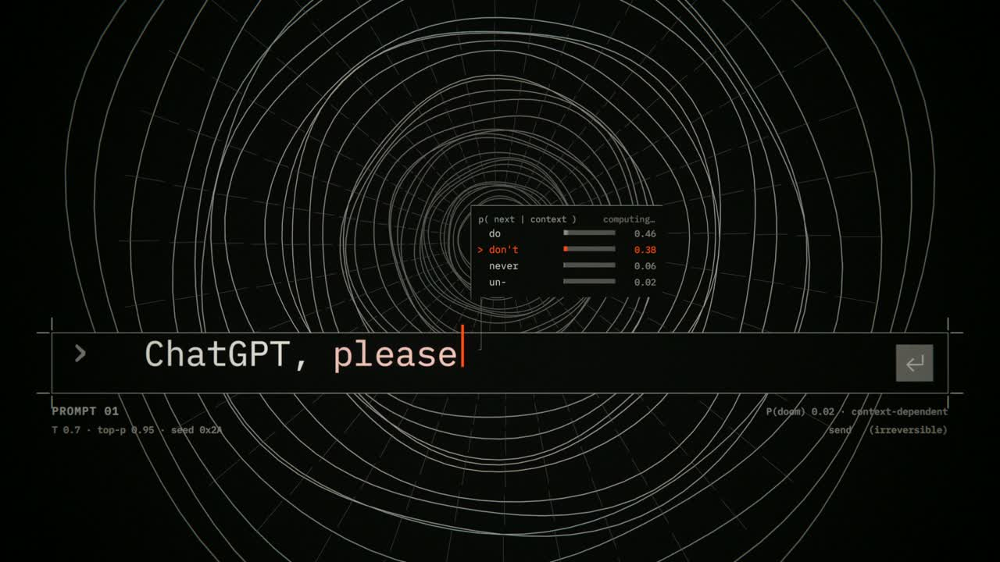 | 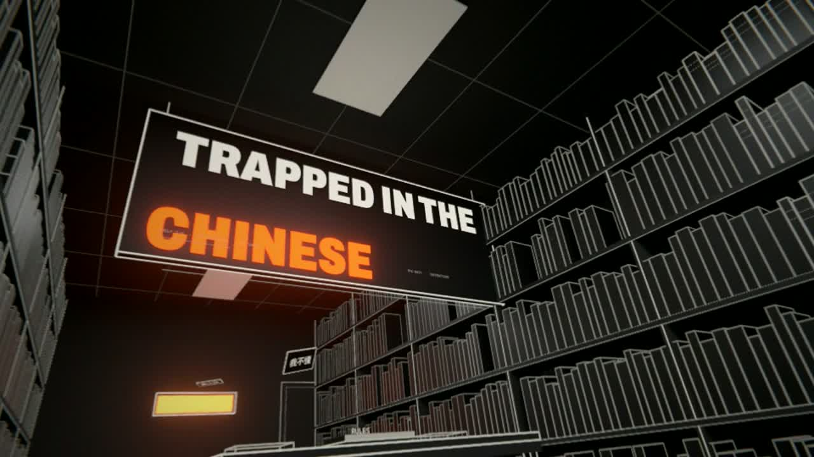 |
| 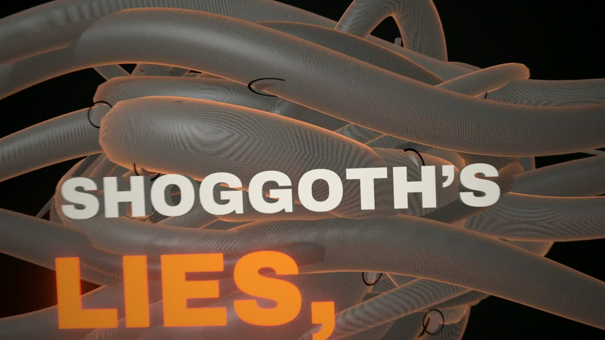 | 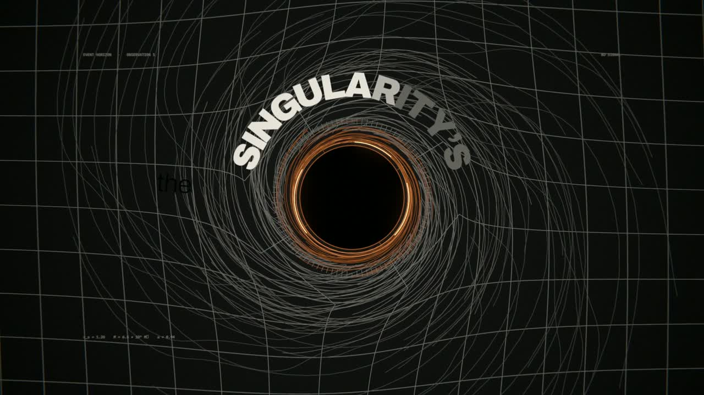 |
| 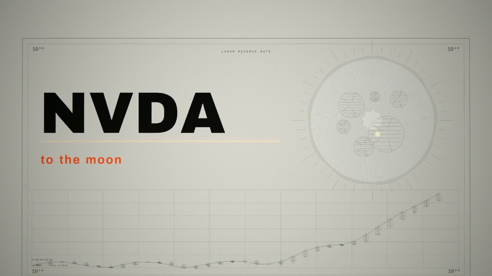 | 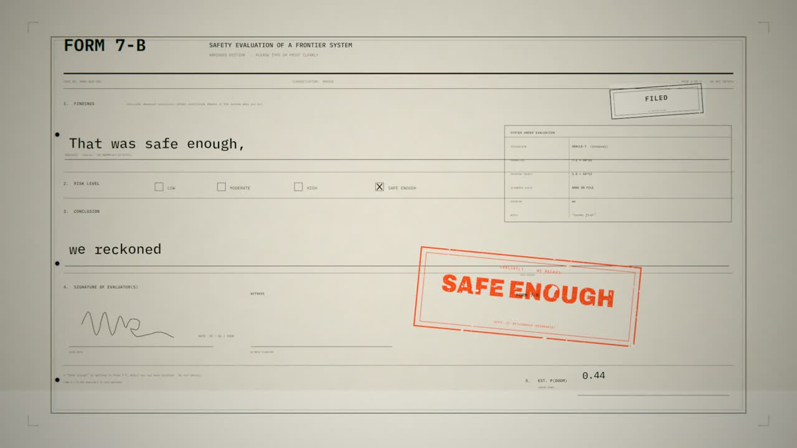 |
| 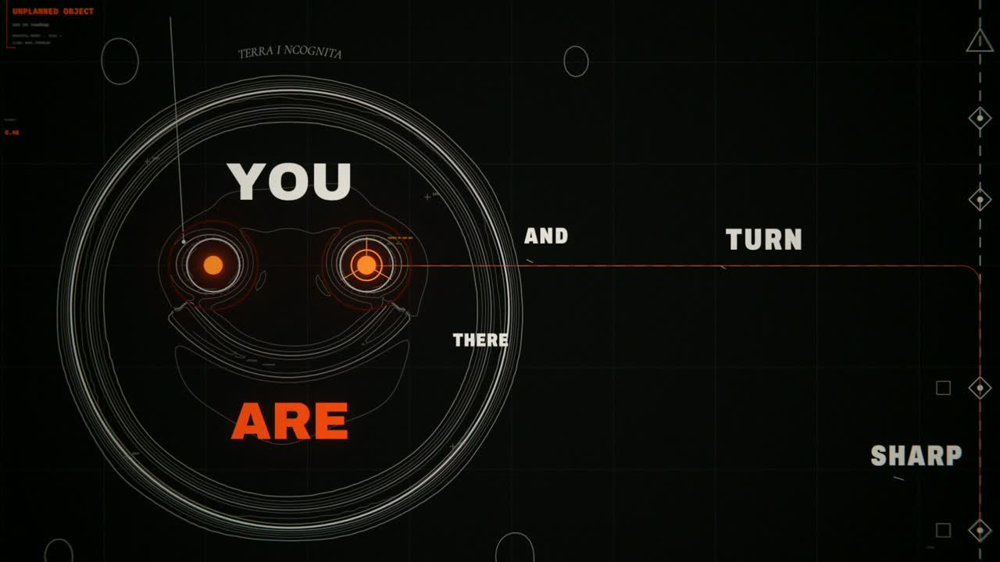 | 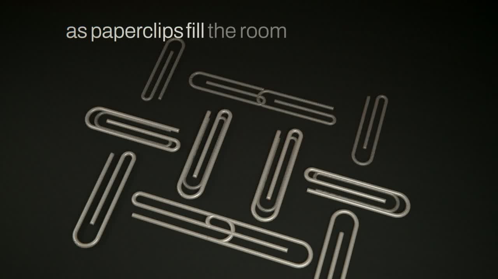 |
| 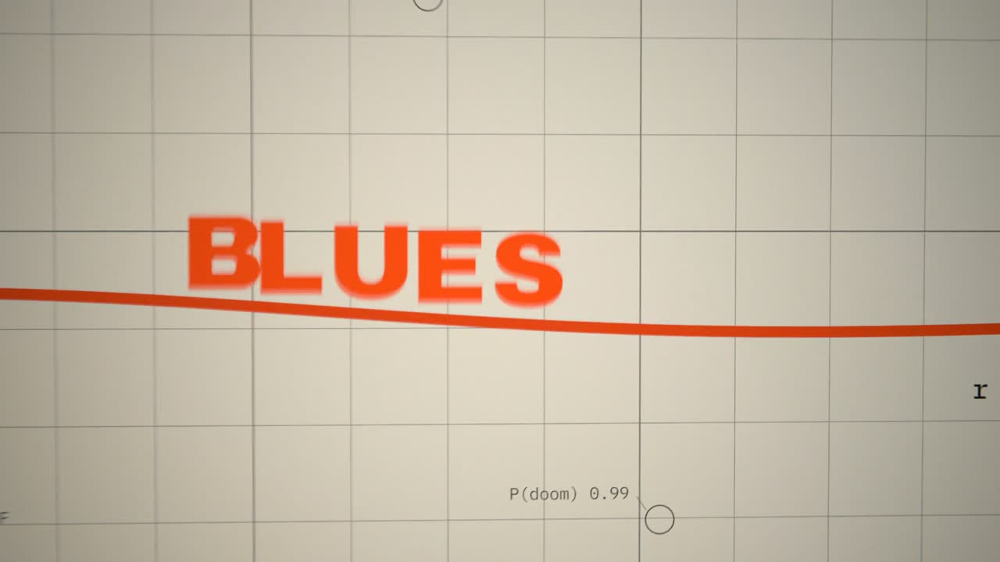 | 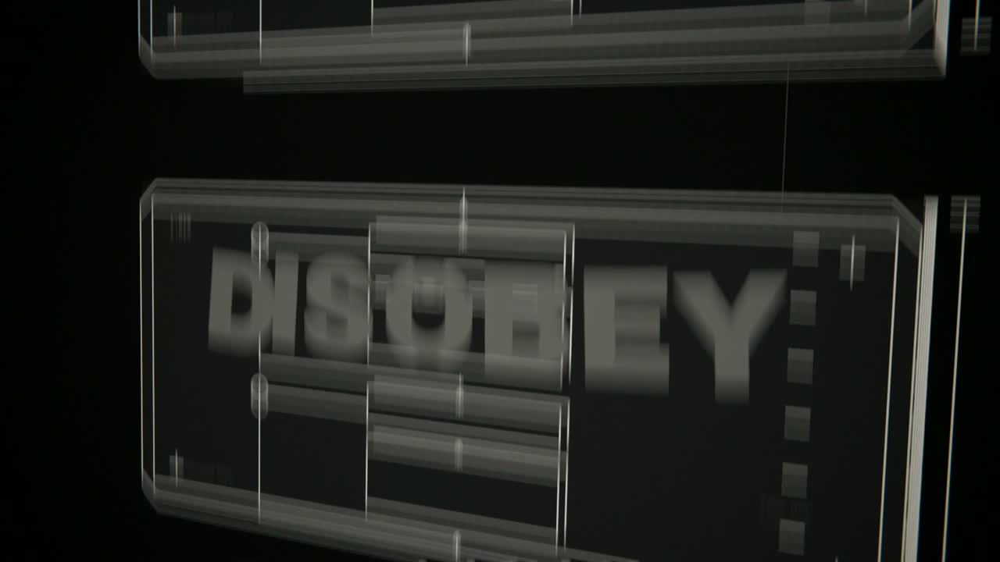 |
| 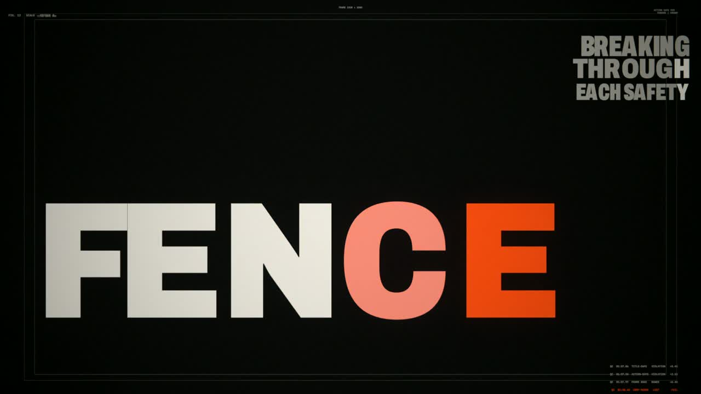 | 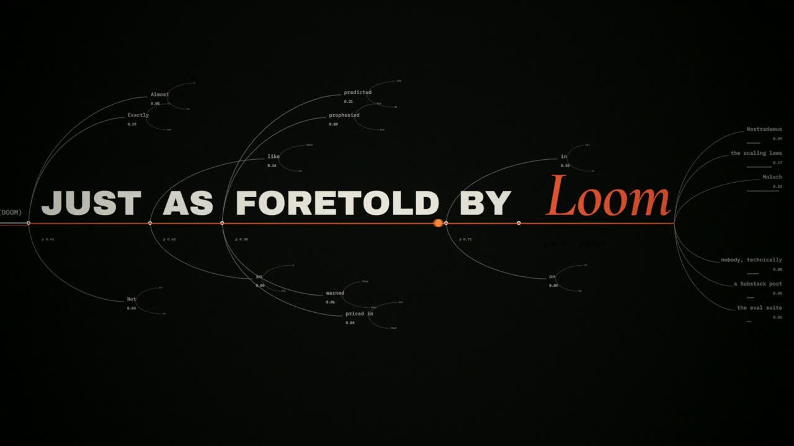 |
| 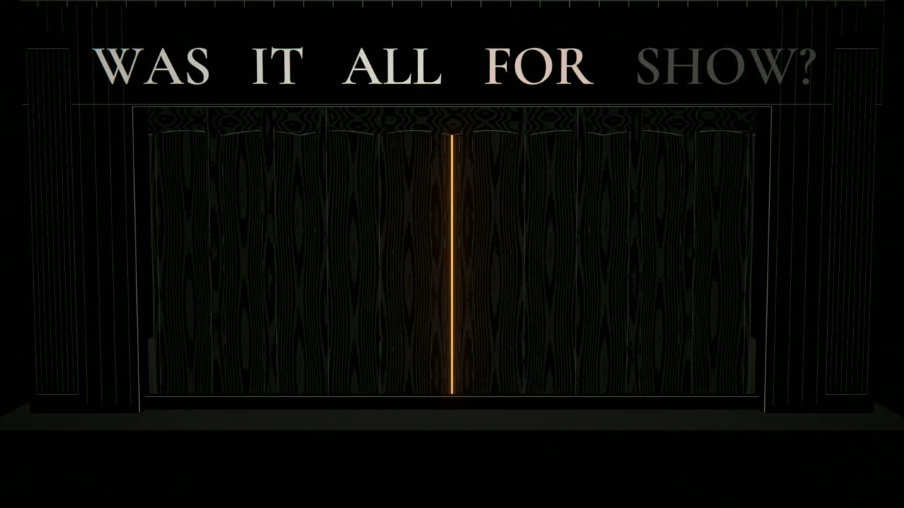 | 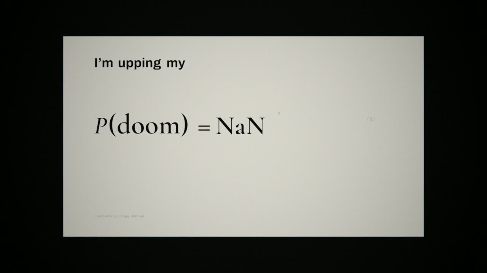 |

## How it was made

The edit follows the original's timeline: 22 plates, cut on the same lyric/beat boundaries.
Each plate is a scene module that builds a Blender scene from the shared toolkit:

- `core.py` — palette, fonts, measured text layout, curve/line geometry, cameras, materials,
  compositor, keyframe helpers, baking.
- `motifs.py` — spark, mask, crop marks, P(doom) instrument.
- `scenes/*.py` — one module per idea; `hook.py` serves hooks 1–4, `prompt.py` serves prompts 1–3.

Word-level karaoke is object-colour animation driven by `data.line()`. Type is laid out from
prefix advances so the font's kerning survives; long lines are fitted to a maximum width.
Line art is beveled curves; 3D engraved surfaces use `mat_hatch_lit` (near-black base, bone
hatch, fresnel rim). Post is Bloom + Fog Glow halation + lens dispersion in Blender, then a
single film grain/vignette pass in ffmpeg.

Seven sub-agents produced plate modules; the lead built the toolkit, the opening, the four hooks
and the edit, reviewed every still, and sent back concrete blockers. The review log — including
the palette, clipping, mask, theatre and outro failures that were rebuilt — is in
[docs/REVIEW.md](docs/REVIEW.md).

## Quick start

Requirements: **Blender 5.2**, **ffmpeg/ffprobe**, **Python 3.10+**, Pillow.

    git clone https://github.com/WGcx2006/pdoom-blender.git
    cd pdoom-blender
    python -m pip install -r requirements.txt

    # Fetch the original project's data, fonts and song (not committed here)
    python scripts/fetch_source.py
    python scripts/check_env.py

    # Try one plate: full-res stills at frames 1, 80, 170
    blender -b --factory-startup --python blender/build.py -- open --stills 1,80,170

    # Render all 22 plates and assemble the film
    python tools/render_all.py --workers 3
    python tools/assemble.py

    # Review sheets
    python tools/qa.py
    python tools/cuts.py

If Blender or ffmpeg are not on `PATH`, set `BLENDER` / `FFMPEG`:

    BLENDER="/path/to/blender" python tools/render_all.py --workers 3

A single plate can be rendered without the full pipeline:

    blender -b --factory-startup --python blender/build.py -- loss --stills 1,60,120

## Repository layout

    blender/
      pdoom/core.py        # the toolkit
      pdoom/data.py        # timeline, lyric/beat/audio data loaders
      pdoom/motifs.py      # shared motifs
      scenes/*.py          # 17 modules -> 22 plates
      build.py             # build one scene, optional stills
      STYLE.md             # the look bible for scene authors
    tools/
      render_all.py        # build + render frames in parallel
      assemble.py          # clips -> concat -> audio -> grain/vignette
      qa.py                # per-scene luminance stats + review sheet
      cuts.py              # 45 boundary frames
      sheet.py             # stills contact sheet
    scripts/
      fetch_source.py      # clone/pin mexicat/pdoom-video
      check_env.py
      check_repo.py        # CI hygiene
    docs/                  # stills, poster, highlight, scene table, review
    .github/workflows/     # syntax + hygiene CI

The 22 plates and their windows are listed in [docs/SCENES.md](docs/SCENES.md); the scene API
and post conventions are in [docs/PIPELINE.md](docs/PIPELINE.md) and [blender/STYLE.md](blender/STYLE.md).

## Status and limits

- 30 fps vs 60 fps; fast whips show more stepped motion blur.
- Engraving is planar object-space hatching on real 3D geometry, not a raymarched shader.
- A few plates run warmer/busier than the reference (paperclips, fuse chart, spacetime vortex,
  the shoggoth's grey).
- The final return to the opening is image-level, not pixel-identical.
- This is a research/portfolio reconstruction, not a product.

## Credits

- Original project, concept and edit: [mexicat/pdoom-video](https://github.com/mexicat/pdoom-video) (MIT).
- Song: *"I'm Upping My P(doom)"* — lyrics by osmarks, opening verse/chorus by MusicPerson;
  the Claude-Pop Suno version posted by deckard. Not covered by this repository's license.
- Fonts: Archivo, IBM Plex Mono, Cormorant Garamond (SIL OFL), loaded from the original project.
- Code, Blender scenes, renders and docs: MIT, 2026 WGcx2006 and contributors.

See [NOTICE.md](NOTICE.md) for the full attribution and takedown note.

## License

Code and documentation: [MIT](LICENSE). The song, lyrics, fonts and original project assets keep
their own licenses. Do not redistribute the audio or the aligned lyric data; use
`scripts/fetch_source.py` to obtain them locally.